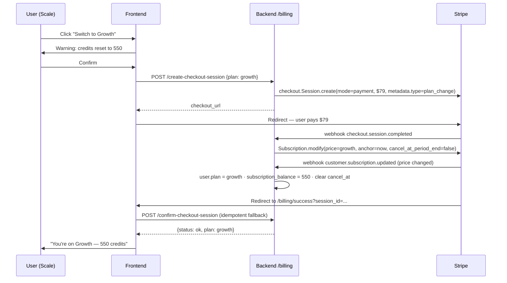

# Plan Change Flow — Credit-Based Upgrades & Downgrades

**Status:** ✅ Implemented — 2026-07-07, branch `feature/source-changes` (pending staging verification, §6)
**Date:** 2026-07-07
**Owner:** Billing

> **Update (2026-07-12) — credit pools.** Credits were since split into three
> independent pools (`lead`, `email_gen`, `outreach`; see
> `backend/BILLING_API_DOCUMENTATION.md`). Everything in this document still applies,
> but **per pool**: a downgrade SETs each pool's subscription bucket to the new plan's
> per-pool allowance, an upgrade ADDs each pool's allowance, and top-up buckets remain
> untouched per pool. Function renames since this was written:
> `add_credits(...)` → `grant_plan_credits(db, user_id, amounts_by_pool, ...)`,
> `subscription_credit_amount(plan, interval)` → `subscription_credit_amounts(plan, interval)`
> (returns a per-pool dict), and `apply_subscription_renewal` now takes that dict.
> Credit numbers quoted below (550, 1200, 1470, …) refer to the old single-balance
> lead-equivalent amounts.

---

## 1. Problem

Downgrading is currently blocked. A user on **Scale** who clicks **Growth** gets:

> "You cannot downgrade to growth directly. Please cancel your current scale
> subscription first and then subscribe to growth."

But cancelling does **not** help: `/billing/cancel` only sets
`cancel_at_period_end=True` in Stripe. The user's `plan` stays `"scale"` and
`stripe_subscription_id` stays set until the period actually expires, so the
rank check in `create_checkout_session` keeps rejecting the downgrade with the
same message — telling the user to do something they already did. Dead end.

Real case (staging, 2026-07-06): user on Scale with **2/1470 credits left**,
cancelled, tried to subscribe to Growth, blocked until period end.

## 2. Product decision — value is credits, not time

A plan's value is its **credit allowance**, not the calendar period.
A Scale user who has spent their 1,200 credits has consumed what they paid
for. When they switch to Growth they should:

- pay the **full Growth price immediately**, and
- immediately receive the **Growth value** (550 credits, Growth features) —
  **not** keep any Scale value.

This is identical to how upgrades already work in this codebase (full charge
today, billing cycle resets today, no proration). Downgrades simply reuse the
same machinery with one difference in credit handling (see §4.3).

### Consequence (signed off)

If a user downgrades while still holding unused subscription credits (e.g.
900 Scale credits left), those are **replaced** by the new allowance (550) —
not merged, not kept. The frontend must warn before checkout:

> "Switching to Growth resets your plan credits to 550 — you currently have 900."

One-time **top-up credits are never touched** (existing rule everywhere:
renewals, downgrades, cancels — the `topup_balance` bucket survives).

## 3. The new flow

### 3.1 User journey

```
User on Scale (active OR cancelled) ──clicks──▶ Growth card "Switch plan"
        │
        ▼
Frontend shows credit-reset warning dialog
  "You have 900 plan credits. Switching to Growth resets them to 550. Continue?"
        │ confirm
        ▼
POST /billing/create-checkout-session {plan: "growth", billing_interval: "month"}
        │
        ▼
Stripe Checkout (mode=payment) — full Growth price, $79, charged TODAY
        │ pays
        ▼
┌────────────────────────────────────────────────────────────────────┐
│ Applied by webhook (or confirm endpoint if webhook is delayed):    │
│  • Subscription price swapped to Growth price                      │
│  • billing_cycle_anchor="now"  → next charge $79 one month from now│
│  • cancel_at_period_end=False  → any pending cancellation wiped    │
│  • user.plan = "growth"        → features flip instantly           │
│  • subscription_balance SET to 550 (not added)                     │
│  • topup_balance untouched                                         │
└────────────────────────────────────────────────────────────────────┘
        │
        ▼
User is a Growth user, right now. 550 credits. Next renewal: $79.
```

### 3.2 Sequence (webhook-first, the normal path)



If webhooks are delayed/unreachable (local dev), `/confirm-checkout-session`
performs the same swap + plan flip + credit set itself. Both paths are
idempotent: whoever flips `user.plan` first wins, the other sees the plan
already matches and skips. Setting the balance twice is also naturally
idempotent (`SET 550` then `SET 550`).

### 3.3 What changes at the moment of the flip

| Aspect                    | Scale (before)     | Growth (after, instant)  |
| ------------------------- | ------------------ | ------------------------ |
| `user.plan`               | `scale`            | `growth`                 |
| Subscription credits      | whatever remained  | **exactly 550**          |
| Top-up credits            | untouched          | untouched                |
| Leads per search          | 500                | 300                      |
| Grid search radius        | 7 km               | 6 km                     |
| Personalization           | Deep + research    | Deep (no ext. research)  |
| Email tone tiers          | Scale tier         | Growth tier              |
| Pending cancellation      | (maybe set)        | cleared                  |
| Next charge               | —                  | $79, one month from today|

Feature gates need **no changes** — they all read `user.plan` live per
request (`chat_service`, `personalization.py`, `email_tones.py`,
`topup/options`).

### 3.4 Interaction rules

- **Upgrade** (e.g. Growth → Scale): unchanged, works as today (full charge,
  cycle resets, credits **added** on top — existing behavior kept to limit
  scope).
- **Downgrade** (e.g. Scale → Growth): full charge, cycle resets, credits
  **set** to new allowance.
- **Cancelled + pick same plan**: still blocked until expiry (existing check,
  unchanged) — otherwise "cancel then rebuy" would be a free credit refill.
- **Cancelled + pick a different plan** (up or down): allowed; the plan change
  clears the cancellation.
- **Downgrade to Free**: not a checkout — that is just `/billing/cancel`
  (unchanged: expires at period end, then `subscription.deleted` webhook sets
  plan to free).

## 4. Implementation plan

All backend work is in `backend/app/api/v1/billing.py` and
`backend/app/services/credit_service.py`. **No DB migration. No Stripe
Subscription Schedules.**

### 4.1 `create_checkout_session` — remove the block

`backend/app/api/v1/billing.py` (~line 302–310):

- Delete the `new_rank < current_rank` → HTTP 400 branch.
- Let downgrades fall through to the existing "modify existing subscription"
  checkout: `mode="payment"`, full new-plan price, metadata
  `{type, plan, billing_interval, user_id}`.
- Metadata `type`: keep `"upgrade"` for both directions (webhook/confirm
  already key off it) — optionally rename the checkout line-item copy from
  "Upgrade to Growth plan" to "Switch to Growth plan" when the target rank is
  lower.
- Keep both existing guards that come before it:
  - cancelled + same plan → blocked until expiry
  - same plan + same interval, not cancelling → "already on this plan"

### 4.2 Response shape — unchanged

Both directions return `{"checkout_url": ...}`. The frontend flow is identical
for upgrade and downgrade; only the pre-checkout warning dialog differs.

### 4.3 Credit application — SET on downgrade, ADD on upgrade

Two places apply the plan change; both must use the same rule:

**Rule:** `is_downgrade = plan_rank[new_plan] < plan_rank[old_plan]`
- upgrade → `add_credits(...)` (unchanged)
- downgrade → `apply_subscription_renewal(db, user_id, new_allowance, "Switched from {old} to {new} plan")`
  — this **sets** `subscription_balance` (existing function used by renewals,
  already writes a `subscription_grant` ledger row with the net delta) and
  never touches `topup_balance`.

Places to change:

1. **`confirm_checkout_session`** (~line 426–478, the
   `mode=payment, type=upgrade` branch): currently always
   `add_credits(new_credits)`. Branch on `is_downgrade`.
2. **Webhook `customer.subscription.updated`** (~line 1088–1104): currently
   `if is_upgrade: add_credits(...) else: commit()` — the `else` silently
   skips credits because until now a price decrease only happened via
   period-end scenarios. Change the `else` (downgrade) branch to
   `apply_subscription_renewal(...)` with the new allowance.

Idempotency between the two paths is preserved by the existing plan guard:
each path first checks whether `user.plan` already equals the target plan and
skips credit work if so (same pattern upgrades use today).

### 4.4 Webhook `checkout.session.completed` (upgrade branch, ~line 899–935)

No logic change needed — it swaps the subscription price with
`billing_cycle_anchor="now"`, `proration_behavior="none"`,
`cancel_at_period_end=False`, which is exactly what downgrades need too.
Verify only that the log line doesn't say "upgrade" unconditionally.

### 4.5 `invoice.paid` renewal hardening (~line 1010–1043)

Today the renewal grant uses `user.plan`. If a plan-change and a cycle
renewal ever land close together (webhook ordering is not guaranteed), the
wrong allowance could be granted. Harden: resolve the plan from the
**invoice line's price id** via `get_price_map(settings)` and fall back to
`user.plan` when the price isn't in the map. Low-risk, closes the ordering
race for all plan changes.

### 4.6 Frontend

Files: `Frontend/src/shared/services/api.ts`,
`Frontend/src/features/dashboard/components/UserProfile/UserProfile.tsx`.

1. **Warning dialog before downgrade checkout** — when target plan rank <
   current plan rank, show:
   - current remaining plan credits (from `/billing/credits/balance`)
   - the new allowance (already served per-plan by `/billing/subscription` /
     plan constants)
   - copy: *"Switching to {Plan} resets your plan credits to {N}. You
     currently have {M}. Your card is charged {$price} today and your billing
     cycle restarts."*
2. **Remove/stop expecting the downgrade-blocked toast** — the 400 no longer
   happens for cross-plan changes.
3. Button label on lower-tier cards: "Switch plan" instead of "Upgrade plan"
   (cosmetic, optional).

No API type changes required (`checkout_url` response is unchanged).

### 4.7 Out of scope (explicitly)

- Proration / refunds — none, by design.
- Downgrade scheduling at period end — rejected in favor of credit-based
  immediate switch.
- Changing upgrade credit semantics (still additive).
- `pending_plan` DB columns, Stripe Subscription Schedules, undo flow — not
  needed in this design.

## 5. Edge cases

| Case | Behavior |
| ---- | -------- |
| Cancelled Scale user buys Growth | Allowed. Cancellation cleared, cycle resets today, plan = growth, credits = 550. |
| Cancelled Scale user buys Scale again | Still blocked until expiry (prevents cancel-and-rebuy credit refill). |
| User with 900 Scale credits downgrades | Warned in UI; ends with exactly 550. |
| User with 0 credits downgrades | Ends with 550 — the motivating case. |
| Webhook arrives before redirect confirm | Confirm sees `user.plan` already updated → `already_active`, no double credit. |
| Confirm runs first, webhook later | Webhook's `subscription.updated` sees plan already matches → same-plan branch, no double credit. |
| Duplicate Stripe webhook delivery | Already handled by `ProcessedWebhookEvent` claim-before-side-effects. |
| Annual ↔ monthly across tiers | `billing_interval` metadata drives `subscription_credit_amount(plan, interval)`; annual = 12× monthly allowance (existing rule). |
| Downgrade to free | Not via checkout — `/billing/cancel` as today. |

## 6. Verification plan (staging, Stripe test mode)

1. **Scale (active) → Growth**: pay with test card → plan flips instantly,
   subscription balance becomes exactly 550, top-ups untouched, Stripe
   subscription shows Growth price with today's anchor and
   `cancel_at_period_end=false`.
2. **Scale (cancelled) → Growth**: the screenshot scenario — must succeed;
   cancellation flag cleared in Stripe and `subscription_cancel_at` null in DB.
3. **Growth → Scale (upgrade)**: unchanged behavior — credits added on top.
4. **Cancelled Scale → Scale**: still blocked with the "wait until expiry"
   message.
5. **Webhook-race check**: replay `customer.subscription.updated` +
   `invoice.paid` in both orders against a test user; balance must end at the
   new plan's allowance either way.
6. **Free-plan cap regression**: free users' 20-credit cap and top-up denial
   unaffected.

---

# Problem 2 — "Not Found" when buying the current plan at 0 credits

**Status:** ✅ Implemented (Fix 2) — 2026-07-07, branch `feature/source-changes`
**Date:** 2026-07-07

## P2.1 Problem

Staging, user on **Scale with 0/1470 credits**: clicking the button on their
**own plan's card** (labeled "Upgrade plan") shows a toast that just says
**"Not Found"**. Buying a *different* plan works — only the same-plan
purchase fails.

## P2.2 Root cause

That button is not the upgrade flow. When the card is the user's **current
plan** and `creditBalance <= 0`, `BillingPage.tsx` (~line 372–398) swaps the
"Current plan" label for a **mid-cycle refill** button (confusingly also
labeled "Upgrade plan"). It calls:

```
POST /billing/create-plan-refill-session      (api.ts ~line 2342)
```

**That route no longer exists in the backend.** FastAPI answers with its
default 404 body `{"detail": "Not Found"}`, and the frontend toast prints the
`detail` string verbatim → "Not Found".

Git history:

| Commit | Date | What it did |
| ------ | ---- | ----------- |
| `d328979` | 2026-04-03 | Added the full refill feature: backend route + confirm branch + webhook branch + frontend button. |
| `61862e5` | 2026-04-17 "updated payment changes" | **Deleted the entire backend half** (route, confirm branch, webhook branch, import) but **left the frontend button and API call in place**. |

So since 2026-04-17, every user who exhausts their credits and clicks their
own plan's card gets "Not Found". Orphaned leftovers still in the code:

- `grant_plan_period_refill_if_new` + `plan_period_refill_description` in
  `backend/app/services/credit_service.py` (~line 228–257) — defined, never
  called.
- `"refill": False` fields in the two `confirm_checkout_session` responses in
  `backend/app/api/v1/billing.py` (~line 434, 478).
- `refill?: boolean` on `BillingConfirmCheckoutResponse` in `api.ts`
  (~line 852) and the `res.data?.refill` toast branch in `BillingPage.tsx`
  (~line 192).

Note: the cancellation the user performed that day (end date = same day) was
a red herring — the refill button appears for anyone on their current plan
with 0 credits, cancelled or not.

## P2.3 Decision — Fix 2: remove the refill flow entirely

**Product rule:** the current plan's card is never a purchase button.

- Need more credits mid-cycle → **"+ Buy More Credits" top-up** (already
  works, same per-credit rate as the plan, user chooses the amount, Scale cap
  2,000/purchase fully covers the old 1,200 refill).
- Want the same plan again → only possible after **cancel + expiry**
  (existing backend check already enforces the wait).
- Want a different plan → normal plan-change checkout (see Problem 1 design
  above).

Fix 1 (restoring the deleted backend route) was rejected: it would
reintroduce a second purchase path that duplicates top-ups, and the backend
removal in `61862e5` appears to have been a deliberate product change that
simply missed the frontend cleanup.

## P2.4 Implementation plan

Frontend:

1. **`Frontend/src/features/dashboard/components/Billing/BillingPage.tsx`**
   - Delete the `startPlanRefillCheckout` function (~line 246–266).
   - In the card CTA logic (~line 372–399): when `isCurrent`, always render
     `Current plan` — delete the credits-exhausted refill button branch.
   - Delete the now-unused `subscriptionBillingInterval` state and the two
     places that set it from `plan_billing_interval` (~line 133–134, 143–148,
     163–168) — it existed only to price the refill.
   - Post-checkout success toast (~line 192–204): drop the `res.data?.refill`
     branch; key the "Added N credits" copy off `res.data?.credits_added`
     instead (also fixes the copy for top-up confirms landing on
     `/billing/success`).
2. **`Frontend/src/shared/services/api.ts`**
   - Delete `createPlanRefillCheckoutSession` (~line 2337–2345).
   - Delete `refill?: boolean` from `BillingConfirmCheckoutResponse`
     (~line 852); keep `credits_added`.

Backend (dead-code cleanup only, no behavior change):

3. **`backend/app/api/v1/billing.py`** — remove the `"refill": False` keys
   from the two confirm responses (~line 434, 478).
4. **`backend/app/services/credit_service.py`** — remove
   `plan_period_refill_description` and `grant_plan_period_refill_if_new`
   (~line 228–257). Verified: no imports anywhere, no test references.

Optional polish: on the current-plan card when credits are exhausted, show a
small "Out of credits? Buy more credits →" link pointing at the existing
top-up flow instead of a bare "Current plan" label.

## P2.5 Verification

1. User on a paid plan with 0 credits: own card shows "Current plan" (or the
   top-up link) — no purchase button, no "Not Found" possible.
2. Top-up purchase still works end-to-end and the success toast reads
   "Added N credits to your balance."
3. Buying a different plan from that state still works (Problem 1 flow).
4. Frontend typecheck/build passes (removed state/function references).
5. `grep -ri refill` returns nothing in `Frontend/src` and only historical
   docs in `backend/`.

---

# Problem 3 — Regenerating one lead's email kills another lead's email

**Status:** ✅ Implemented (backend fixes 1–4) — 2026-07-07, branch `feature/source-changes`.
Frontend fixes (P3.4 items 5–6: modal pinning, failure visibility/Retry) **descoped by
product decision** — the non-destructive-regeneration fix makes a mis-targeted regen
harmless, and failures should become rare after fixes 1–2. Revisit the per-lead Retry
button if initial-generation failures persist on staging. Note: the modal toast still
says "New draft generated" even when the backend kept the previous draft (the accurate
message is in the API response, unused by the UI).
**Date:** 2026-07-07

## P3.1 Problem

Staging: a 3-lead campaign, all emails generated. The user regenerated lead 1's
email 2–4 times from the preview modal; lead 2's email flipped from Ready to
**Failed** — silently, with no reason shown, no retry offered, and the
previously good draft effectively lost (Failed rows are excluded from launch
and show only a dash).

## P3.2 How generation works (context)

- Step 4 generates per-lead emails: lead 1 synchronously in the request, the
  rest **sequentially** in a background task (`_process_sequential_leads`),
  one commit per lead.
- Each lead gets up to **5 attempts**. Every attempt: build a deterministic
  variation recipe (`variation.py`: shuffled pools, `deck[index % len]`,
  ~8,640 recipe combinations), call the LLM (55s timeout), then two gates:
  a **repetition gate** (3-word-shingle Jaccard ≥ 0.6 vs other leads' emails
  → reject) and a **compliance/spam gate**. 5 failures → row = FAILED.
- Per-lead regenerate (`regenerate_email`) runs the same gauntlet for one row,
  comparing against all other READY bodies.

## P3.3 Root causes (all confirmed in code)

1. **Variation-index collision — regens reuse neighbours' recipes.**
   `variation_index = lead_index + regeneration_count + attempt`
   (`generate_lead_email_row`). The engine is deterministic per
   (campaign_seed, index), and initial generation used index = lead position.
   So regenerating lead 1 (index 0+1=1) produces a draft from **lead 2's
   exact recipe**, which is then similarity-checked against lead 2's email —
   written from that same recipe, same brief, same sender. Retries walk into
   lead 3's recipe, and so on. The regeneration path defeats the variation
   engine by re-entering the lead-index space.
2. **Wrong retry feedback.** When a draft fails the repetition gate, the retry
   prompt tells the LLM *"PREVIOUS DRAFT FAILED SPAM/COMPLIANCE CHECK — avoid
   spam triggers"* (`ai_email_generator.py` compliance_section). The model
   "fixes" spam that wasn't the problem; all 5 attempts fail the same way.
   One-word campaign briefs (e.g. "meet") make collisions near-certain: the
   recipe varies form, but content — brief + sender profile — dominates the
   shingles.
3. **Failed regeneration destroys a good draft.** The failure branch of
   `generate_lead_email_row` stamps FAILED unconditionally. A row that was
   READY loses its launchable status (body text survives in the DB but is
   unreachable in the UI).
4. **The preview modal can silently switch target rows.** `activeRow` falls
   back to `readyRows[0]` when the active id isn't found, an effect rebinds
   `activeRowId` to it, and the list refreshes under the modal every 1.5s
   while anything generates — so a regenerate click can be sent with a
   different row's id than the user believes.
5. **Failures are invisible.** `last_error` is returned by the API but never
   displayed; Failed rows show a dash with no retry; the progress banner
   counts FAILED as "complete" (`complete = ready + failed`).
6. **Sticky cancel flag.** `/cancel` sets an in-memory campaign flag cleared
   only by `/generate`. A later per-lead regenerate silently no-ops
   (row left PENDING) because `generate_lead_email_row` returns early.
7. **(Scale concern)** Every regenerate loads **all** rows' full bodies for the
   repetition check and scans them pairwise per attempt — ~2 MB + 1,000-way
   scans per attempt on a 1,000-lead campaign, while the LLM prompt only ever
   uses the last 3.

## P3.4 Solution

Backend (`campaign_email_generation_service.py`, `campaign_email_review_service.py`,
`ai_email_generator.py`):

1. **De-collide regeneration recipes** — stride regens out of the lead-index
   space: `variation_index = lead_index + total_leads × (regeneration_count + attempt)`.
   Deterministic as before; regens/retries can no longer land on a recipe a
   current lead is using.
2. **Correct retry feedback** — on a repetition-gate failure, tell the LLM the
   draft was *too similar to another lead's email* (include the colliding
   snippet) and to change opener/angle/structure/CTA; reserve the spam wording
   for actual compliance failures.
3. **Non-destructive regeneration** — in `regenerate_email`, hold the row's
   current draft (subject/body/status/spam fields — ~2 KB, request-scoped,
   independent of campaign size) and, if all attempts fail on a previously
   READY row, restore it and return "kept the previous draft" instead of
   FAILED. Also clear the sticky cancel flag at the start of a regenerate.
4. **Cap the repetition list** — compare against the ~25 most recent other
   bodies instead of all rows (prompt already only uses last 3).

Frontend (`CampaignLeadEmailPreviewModal.tsx`, `CampaignLeadEmailGeneration.tsx`):

5. **Pin the modal to its row** — remove the `readyRows[0]` fallback/rebind;
   if the opened row disappears from the list, close the modal. Regenerate
   toast uses the backend message (so "kept the previous draft" surfaces).
6. **Make failures visible & recoverable** — show `last_error` (friendly
   mapping) on Failed rows, add a per-row **Retry** button, and count failures
   separately in the progress banner instead of as "complete".

## P3.5 Out of scope

- Parallel generation — see Problem 4 below.
- Warning the user when the campaign brief is too thin to personalize
  (optional future UX).
- MinHash/LSH similarity index (README-noted future work).

## P3.6 Verification

1. Regenerate one lead 5+ times in a 3-lead campaign — other leads' rows must
   never change status; each regen's `variant_metadata.index` must not equal
   any other lead's index.
2. Force a similarity failure (identical brief, few leads) — retry prompt must
   contain the "too similar" instruction, not the spam one.
3. Force all 5 attempts to fail on a READY row — row stays READY with the old
   draft; response message says the previous draft was kept.
4. Failed row (fresh campaign, forced failure) shows reason + Retry; Retry
   regenerates only that row.
5. Modal opened on lead A never sends lead B's id (regen during list polling).
6. Progress banner shows "N ready · M failed" instead of counting failures as
   complete.

---

# Problem 4 (planned) — Sequential generation too slow for large campaigns

**Status:** Planned, not yet designed in detail — implement after Problem 3

Generation is strictly sequential (~15–30 s/lead): a 500-lead campaign takes
2–4 hours. Plan: bounded-concurrency generation — recipes are already
deterministic per lead (parallel-safe); run a worker pool
(`asyncio.Semaphore`, concurrency ~3–5), each worker with its own session and
commit; keep the repetition gate at commit time (check against committed
emails + drafts finished in the current window, retry the colliding lead
only). UI needs no changes (status polling already reflects DB counts).
Ship separately from Problem 3 so regressions are easy to isolate.
